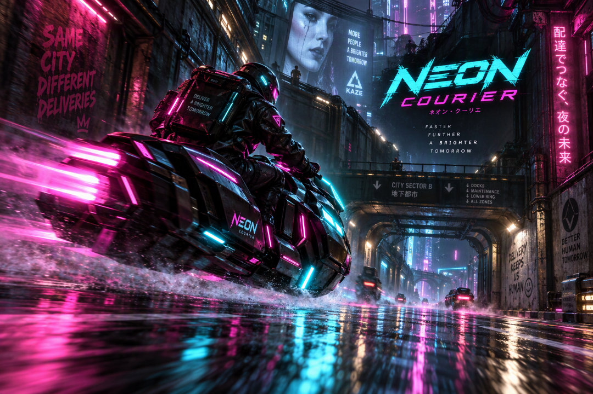
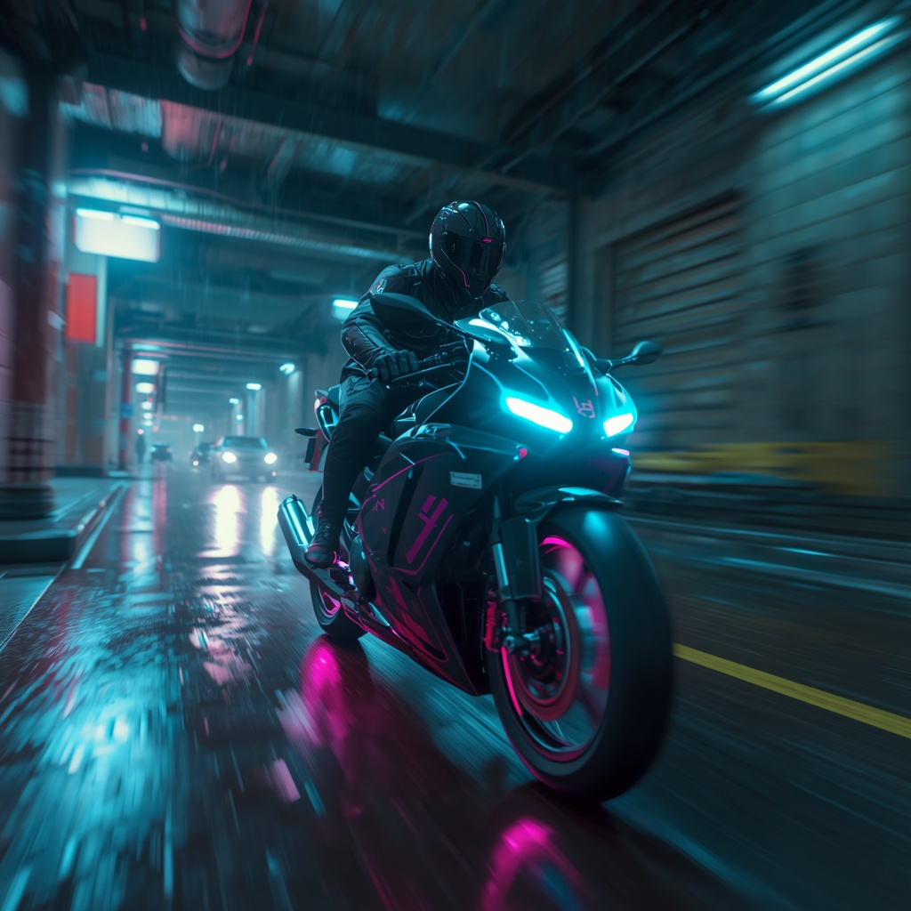
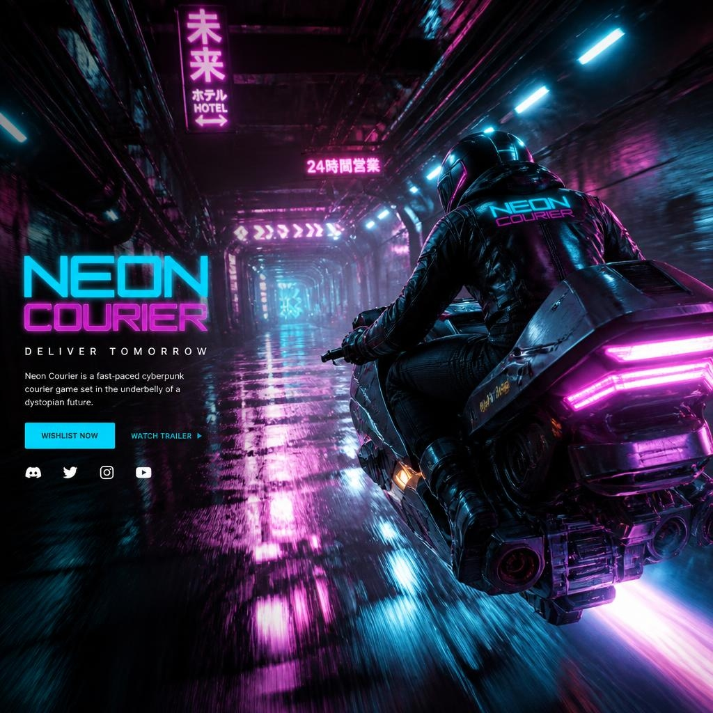

# Neon Courier: UnderCity — Landing Page Oficial 🚀🎮

https://jhonata-franca.github.io/lab-natty-or-not/

## 🎯 Contexto do Desafio

Projeto desenvolvido para o Desafio de Projeto **"Natural ou Fake Natty? Como Vencer na Era das IAs Generativas"** da **DIO (Digital Innovation One)**, com foco em explorar o potencial criativo de IAs Generativas para a criação de conteúdos realistas aplicados ao universo de games e desenvolvimento web.

---

## 📋 Descrição do Projeto

Conceituação completa da landing page de lançamento de **Neon Courier: UnderCity**, um jogo indie fictício ambientado em uma metrópole cyberpunk subterrânea. O jogador assume o papel de um entregador clandestino pilotando uma moto voadora (*hoverbike*) em alta velocidade por túneis esquecidos, transportando cargas perigosas enquanto foge de forças corporativas.

---

## 🤖 Tecnologias Utilizadas

- **ChatGPT / Claude:** Geração de *copywriting*, estrutura da landing page, slogan, narrativa (*lore*) e features de jogabilidade.
- **Bing Image Creator / Microsoft Copilot Designer:** Geração das artes conceituais, cenários, atmosfera e mockups visuais do jogo e do site.
- - **Kling AI:** Geração do teaser em vídeo com física realista e animação de câmera cinematográfica.

  
- **Suno AI:** Geração da trilha sonora oficial instrumental no estilo *Dark Synthwave / 80s Cyberpunk*. 

---

## 🧐 Processo de Criação

1. **Brainstorming & Conceito:** Definição da temática cyberpunk com foco em velocidade, atmosfera de chuva, neons azul e magenta, e estética de submundo futurista.
2. **Engenharia de Prompt (Texto):** Criação de instruções estruturadas para a IA atuar como um *copywriter* sênior de marketing de games, gerando textos comerciais com apelo de urgência e mistério.
3. **Engenharia de Prompt (Imagem):** Refinamento de prompts em inglês focando em detalhes de iluminação volumétrica, reflexos em superfícies molhadas (*octane render / Unreal Engine 5*) e composição panorâmica para banner web.
4. **Curadoria:** Seleção das melhores variações de texto e imagem para compor a identidade visual da página.

---

## 🚀 Resultados & Conteúdo Criado

### 📸 Artes Conceituais & Mockups

#### 1. Banner Principal (Hero Header & Worldbuilding)

#### 2. Mockup da Interface da Landing Page

#### 3. Piloto em Ação nos Túneis (Action Concept)

### 🎧 Trilha Sonora Oficial
- **Música Tema:** [Ouvir no Suno AI (Neon Courier: UnderCity)](https://suno.com/s/JvqFG1OEGwReCGDr)

### ✍️ Destaques da Landing Page
> **"A cidade não dorme. E a morte não espera."**  
> *Você não entrega pacotes. Você entrega destinos.*

- **01. Velocidade Ilegal:** Pilote sua moto voadora por túneis subterrâneos e atalhos perigosos. Reflexos rápidos são sua única vantagem.
- **02. Caçado pelo Sistema:** Fuja de drones armados e bloqueios corporativos. Cada entrega pode transformar você no alvo mais procurado.
- **03. Sobreviva e Evolua:** Aprimore sua moto, domine rotas clandestinas e enfrente entregas cada vez mais arriscadas.

---

## 💭 Reflexão: "Natty or Not?"
O resultado deste experimento mostrou o poder das IAs Generativas na pré-produção criativa. 

- **É "Natty" (Realista)?** Sim! A profundidade dos reflexos nas poças d'água, o trabalho de iluminação neon e a consistência do tom textual transmitem com precisão a sensação de um lançamento de um estúdio profissional de games indie.

- **Conclusão:** Ferramentas de IA aceleram drasticamente a ideação e a criação de protótipos, permitindo que até quem está começando na tecnologia consiga dar vida a projetos visualmente ricos e bem documentados.
